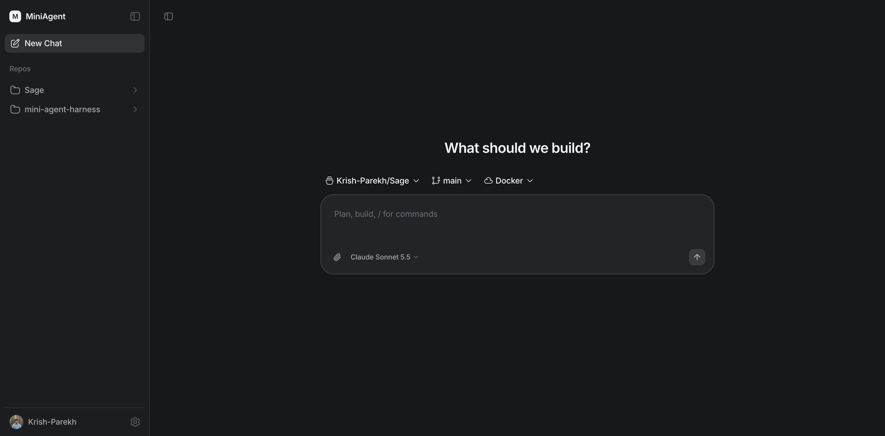
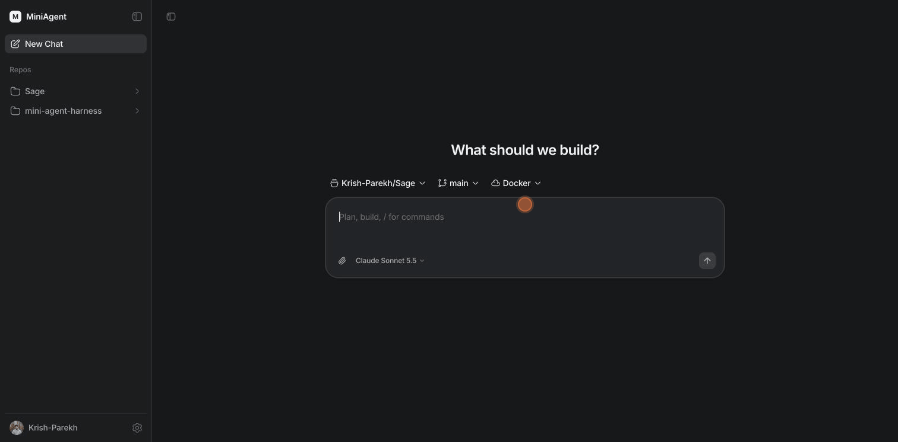
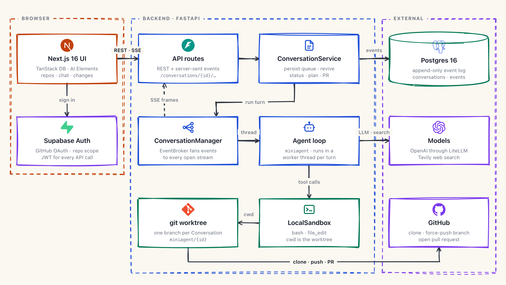
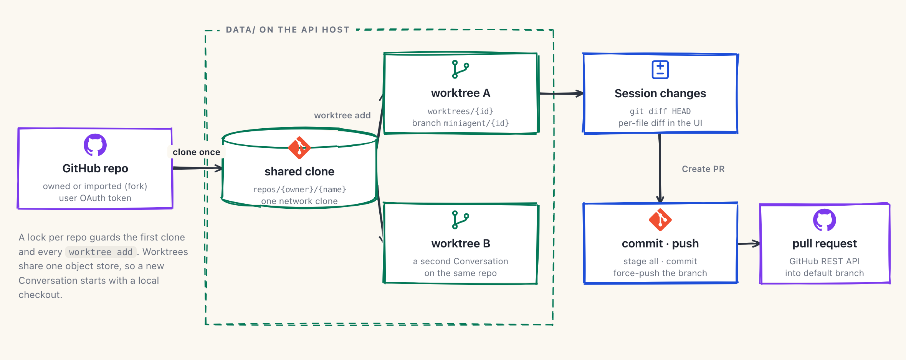
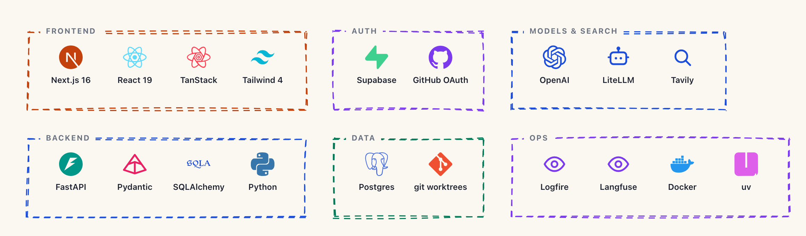

# MiniAgent

MiniAgent is a coding agent that works on your GitHub repositories. You sign in with GitHub and select a repository. Then you give the agent a task in a chat. The agent reads the code, runs shell commands and edits files on its own branch in a sandbox. You review the diff, and the agent can open a pull request.

<p align="center">
  
</p>

Each Conversation gets its own checkout and branch. Two Conversations on the same repository do not change the same files. An append-only event log in Postgres stores every message, action and result, so you can open an old Conversation and replay it.

## How it works

One task from prompt to pull request: the agent reads the repository, adds a `GET /version` endpoint, and shows the change as a per-file diff. Then **Create PR** pushes the branch and opens the pull request.

<p align="center">
  <a href="docs/media/demo.mp4">
    
  </a>
</p>

## System

<picture>
  <source media="(prefers-color-scheme: dark)" srcset="docs/architecture/system-dark.png">
  
</picture>

| Part | Does |
|---|---|
| `frontend/` | Next.js 16 UI. Lists repositories, streams the chat, and shows Session changes as a per-file diff |
| `backend/api` | FastAPI routes. Every request carries a Supabase JWT. Events stream to the browser over server-sent events |
| `backend/service` | Writes each event to Postgres through one queue. Loads a Conversation from the log after a server restart |
| `backend/runtime` | Starts each agent turn in a worker thread. Manages clones, checkouts, diffs and pull requests |
| `miniagent/` | The agent loop, its tools, the policy classifier and the sandbox |

The browser reconnects to the stream with `Last-Event-ID`. The server then sends only the events that the browser did not get. While the agent runs, you can steer it with a new message or queue a message for the next turn.

## One agent turn

1. The agent adds a sketch of the workspace files, the repository instructions and the saved memories.
2. The model replies with text, tool calls, or both.
3. `PolicyClassifier` gives each `bash` command a risk level: `safe`, `mutating`, `dangerous` or `unknown`. A risky command stops the turn until the user approves or rejects it.
4. Calls that are safe to run together share a thread pool. Each result becomes an observation event. A very large output goes to a file, and the model gets a preview.
5. When the history gets near the model's context window, the agent first shortens old tool outputs, then writes a summary of the old events.
6. `StuckDetector` reads the last 20 events. It stops the turn when the agent repeats the same action, fails again and again, or talks without action.

| Tool | Does |
|---|---|
| `bash` | Runs a shell command in the sandbox |
| `grep` · `glob` | Searches file contents and file names with ripgrep |
| `file_edit` | Views, creates and edits files |
| `present_plan` · `update_plan` | Shows a plan for approval, then tracks its steps |
| `ask_user` | Asks the user a question and waits for the answer |
| `memory` | Reads and writes notes that persist across Conversations, for the user and for each repository |
| `skill` · `find_skills` | Loads a skill, or finds one to install |
| `fanout` | Starts read-only workers in parallel and summarises what they find |
| `web_search` · `fetch_url` · `web_research` | Searches the web with Tavily. The agent gets these tools only when you set `TAVILY_API_KEY` |
| `finish` | Ends the task with a summary |

MCP servers that you add in Settings give the agent more tools at runtime.

## Workspaces and pull requests

<picture>
  <source media="(prefers-color-scheme: dark)" srcset="docs/architecture/workspace-dark.png">
  
</picture>

The server clones each repository one time, under `data/repos/{owner}/{name}`, and fetches it again when a new Conversation starts. Each Conversation makes a `git clone --shared` of it under `data/worktrees/{id}` on the branch `miniagent/{id}`. The checkouts share one object store, so a new Conversation does not download the repository again. A lock for each repository protects the shared clone.

Session changes come from `git diff HEAD` in the checkout. **Create PR** stages all files, makes a commit and force-pushes the branch. Then the GitHub REST API opens a pull request into the default branch. The GitHub token comes from the user's own OAuth sign-in. The server never writes the token to an event or a log.

## Sandboxes

By default each Conversation runs its commands in its own Docker container, with the checkout mounted. The container stops when the Conversation is idle. Set `MINIAGENT_SANDBOX_PROVIDER` to run commands on the host (`local`), or in E2B, Daytona, Modal, Vercel or a self-hosted SPACE deployment. Every provider passes the same contract tests. See [`sandbox/README.md`](sandbox/README.md).

## Stack

<picture>
  <source media="(prefers-color-scheme: dark)" srcset="docs/architecture/stack-dark.png">
  
</picture>

## Run it

You need Docker, [uv](https://docs.astral.sh/uv/), [ripgrep](https://github.com/BurntSushi/ripgrep), Node.js 20.9 or later, and a Supabase project with the GitHub provider turned on.

```bash
make install
cp .env.example .env
cp frontend/.env.example frontend/.env.local
docker build -t miniagent-sandbox:latest sandbox
uv run alembic upgrade head
make supabase
make dev
```

`make supabase` creates the Storage bucket for attachments. `make dev` starts Postgres, the API on port 8000 and the UI on port 3000.

| Variable | File | Needed for |
|---|---|---|
| `ANTHROPIC_API_KEY` | `.env` | The agent model and the policy classifier |
| `SUPABASE_URL` | `.env` | JWT checks on the API |
| `SUPABASE_DATABASE_URL` | `.env` | `make supabase`. Use the session pooler URL |
| `DATABASE_URL` | `.env` | The event log |
| `MINIAGENT_SANDBOX_PROVIDER` | `.env` | Where commands run. Default `docker` |
| `TAVILY_API_KEY` | `.env` | Web tools. Optional |
| `LANGFUSE_*` | `.env` | LLM traces. Optional |
| `NEXT_PUBLIC_SUPABASE_URL` · `NEXT_PUBLIC_SUPABASE_PUBLISHABLE_KEY` | `frontend/.env.local` | Sign-in in the browser |
| `NEXT_PUBLIC_API_URL` | `frontend/.env.local` | The API address |

The default model is `anthropic/claude-sonnet-5-5`, and the policy classifier uses `anthropic/claude-haiku-5-5`. To change them, set `MINIAGENT_MODEL` and `MINIAGENT_POLICY_MODEL`. Both values go through LiteLLM, so any model that LiteLLM supports can work.

Tests:

```bash
uv run pytest tests/
```

## Roadmap

- [x] Plan mode
- [x] Open a pull request at the end of a task
- [x] Postgres event store (`ConversationRow` and `EventRow` with JSONB)
- [x] Sandbox providers: Docker, E2B, Daytona, Modal, Vercel and SPACE behind the `Sandbox` interface
- [x] Condenser: shorten old tool outputs, then summarise old events near the context window
- [x] Memory, skills and MCP tools
- [x] Steer or queue messages while the agent runs
- [ ] Keep the GitHub token so that the agent can make commits
- [ ] Fan-out for sub-agents that can edit code
- [ ] Better recovery when a turn fails
