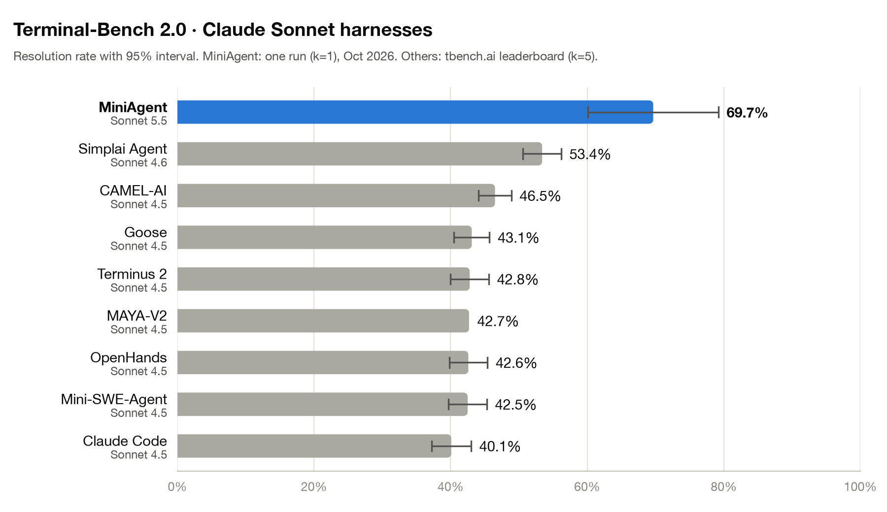

# Terminal-Bench 2.0

MiniAgent runs on [Terminal-Bench 2.0](https://www.tbench.ai/) through the Harbor adapter in `miniagent/harbor/`. The agent loop runs on the host, and every command runs in the task's container.

Run the full set (Docker running, about 3 hours at `-n 4`):

```bash
uv run harbor run -d terminal-bench@2.0 -a miniagent.harbor:MiniAgent -m anthropic/claude-sonnet-5-5 -n 4 -o evals/results/harbor
```

Browse the trajectories, grader output and timings of every trial:

```bash
uv run harbor view evals/results/harbor --jobs
```

`scripts/tb-smoke.sh` runs an 8-task subset for quick checks.

## First full run (2026-10-26)

MiniAgent with `anthropic/claude-sonnet-5-5`, one attempt per task (k=1), 4 at a time, on a MacBook (Apple Silicon, Docker Desktop). Job `evals/results/harbor/2026-10-25__13-00-09`.

| Tasks | Passed | Score | Agent timeouts | Infra errors | Cost |
|---|---|---|---|---|---|
| 89 | 62 | **69.7%** | 4 | 0 | $20.06 |

Tokens: 44.6M input (96% from cache), 1.15M output.

Why the 27 failed trials failed:

| Cause | Trials | Count |
|---|---|---|
| Harness: a hung `apt-get` outlived the agent and locked out the grader | torch-tensor-parallelism, torch-pipeline-parallelism, polyglot-c-py, extract-moves-from-video, adaptive-rejection-sampler, compile-compcert, merge-diff-arc-agi-task, sparql-university | 8 |
| Harness: the output limit threw the work away | regex-chess | 1 |
| Model refused (empty reply) | break-filter-js-from-html, crack-7z-hash, vulnerable-secret | 3 |
| Task or machine | qemu-startup, qemu-alpine-ssh, caffe-cifar-10, configure-git-webserver | 4 |
| Model mistake | train-fasttext, sam-cell-seg, make-mips-interpreter, make-doom-for-mips, install-windows-3.11, gcode-to-text, db-wal-recovery, dna-insert, filter-js-from-html, mteb-leaderboard, mteb-retrieve | 11 |

In 10 of the 27 the grader's tests never ran: the 8 apt trials, and the 2 QEMU tasks whose grader could not download `curl`.

Leaving out the 3 trials that fail only because the Mac emulates x86 (the two QEMU tasks and caffe-cifar-10), the score is 62/86 (72%).

### Against other harnesses



The leaderboard (checked 2026-10-26) has no Sonnet 5.5 entry on 2.0 or 2.1. The only one is Claude Code on Terminal-Bench 4.0, a different and harder set (61.8%). The chart therefore sets MiniAgent next to the 2.0 entries that use Sonnet 4.5 and 4.6, with their published 95% intervals. MiniAgent's interval is the binomial interval of a single run (about ±9.5 points). Regenerate it with:

```bash
uv run --with matplotlib python scripts/tb-chart.py docs/media
```

Next: run Terminus 2, Harbor's reference harness, with Sonnet 5.5 on the same 89 tasks and add it to the chart. That is the same-model comparison the leaderboard does not have.

---

## Fix plan

Ordered by the trials each fix can win back.

### 1. A hung `apt-get` outlives the agent and breaks the grader (8 trials)

**What happens.** The agent runs `apt-get install ...` in the `terminal` tool. The tmux pane gives apt a terminal, and `DEBIAN_FRONTEND` is not set, so debconf stops at a question (tzdata and similar) that the agent cannot see when output goes to a log. The headless prompt says never to interrupt apt, so the agent waits until the time budget runs out. The run ends with apt still alive. The grader's `test.sh` then runs `apt-get install curl`, cannot get the dpkg lock, and scores 0 without running a test.

**Evidence.** Every one of the 8 trials has `Could not get lock /var/lib/dpkg/lock-frontend ... held by process N (apt-get)` followed by `curl: command not found` and `uvx: command not found` in `verifier/test-stdout.txt`. `polyglot-c-py` had a correct `main.py.c` and was never graded. `extract-moves-from-video` waited 29 minutes on apt.

**Where.**
- `TerminalSession._start` (`miniagent/tools/terminal.py`) sets up the shell but does not export `DEBIAN_FRONTEND`. Only Harbor setup's own install sets it (`miniagent/harbor/agent.py:40`).
- `MiniAgent.run` (`miniagent/harbor/agent.py`) never calls `conversation.agent.close()`, so `TerminalSession._end_session`, which kills the processes on the pane's tty, never runs in Harbor. Only `miniagent/cli.py` calls it.
- `miniagent/prompts/headless.md`: "Never interrupt, kill or reset the terminal while apt, dpkg or pip is running."

**Plan.**
1. Export `DEBIAN_FRONTEND=noninteractive` in `TerminalSession._start`. This removes the hidden prompt, which is the root cause.
2. Call `conversation.agent.close()` in the `finally` of `MiniAgent.run`, so nothing the agent started is alive when the grader runs. Killing apt during dpkg's unpack can leave dpkg "interrupted", so this is the backstop, not the fix.
3. Replace the "never interrupt apt" rule: when an install stalls, read its log; if it waits on a prompt, stop it with `C-c` and rerun it non-interactively.

**Status: planned.**

### 2. The `finish` check is slow and keeps rejecting (cost the time in 1 trial, steps in many)

**What happens.** On `finish`, `has_unverified_changes` classifies every terminal command with one Haiku call each, one after another. The first `finish` took 57–122 s. After a rejection, the agent's cleanup (`rm` of a stray file) counts as a new workspace change, so the next `finish` is rejected again. The classifier also rejects "no test applies, I checked by hand".

**Evidence.** sam-cell-seg was rejected about 13 times, install-windows-3.11 8 times, extract-moves-from-video 9 times before the stuck detector ended it. make-doom-for-mips had a working build and hit `AgentTimeoutError` inside the check.

**Where.** `Conversation.has_unverified_changes` (`miniagent/conversation.py:353`), the gate in `miniagent/agent.py` (around line 1105), `_FINISH_POLICY_SYSTEM` in `miniagent/policy.py`. Headless runs also get the double-`finish` checklist.

**Options (decision needed).**
- Classify each command once, when it runs, so `finish` reads cached results.
- Reject at most once per workspace state, and never for cleanup-only commands.
- Turn the check off for the headless preset, where the double-`finish` checklist already covers it.

**Status: open.**

### 3. A heredoc followed by another line is rejected as "multiple commands"

**What happens.** `cat > f <<'E' ... E` followed by a line that runs the file is rejected with "Cannot execute multiple commands at once". The agent retries with the commands split, one wasted turn each time.

**Evidence.** About 10 trials, 1–6 times each: gcode-to-text (5), polyglot-c-py, sam-cell-seg, train-fasttext, make-doom-for-mips, install-windows-3.11, merge-diff-arc-agi-task, configure-git-webserver, dna-insert.

**Where.** `_split_bash_commands` and its use in `_execute` (`miniagent/tools/terminal.py`).

**Plan.** Treat a multi-line input as one script instead of splitting on top-level newlines.

**Status: planned.**

### 4. A response cut off by the output limit loses its tool call (1 trial)

**What happens.** The model writes a whole generator in one tool call, hits `max_tokens`, and the cut-off call is dropped. The next response starts from nothing and hits the limit again. After 3 in a row the run stops.

**Evidence.** regex-chess: every response used exactly 16,384 completion tokens; `re.json` was never written.

**Where.** `max_tokens` in `miniagent/config.py:23`; the output-limit handling in `miniagent/agent.py` (around lines 297–322).

**Plan.** Keep the start of the cut-off call in the notice, so the model can see how far it got and split the work into smaller files.

**Status: planned.**

### 5. A refusal is logged as "empty model response" (3 trials)

**What happens.** On the security-flavoured tasks the model returns 0 completion tokens twice, and the run ends with `empty model response`. The cause is a refusal, but `LLMResponse` only keeps whether `finish_reason` was `length`, so the log does not say so.

**Where.** `miniagent/llm.py:284`, `miniagent/agent.py:326`.

**Plan.** Keep `finish_reason` on `LLMResponse` and name it in the error event. This does not change the score; it makes the failure readable.

**Status: planned.**

### To confirm

- polyglot-c-py: a terminal poll failed with a transport error, and the next command was typed into the still-running apt. The poll error should leave the session marked as running (`miniagent/tools/terminal.py`).
- compile-compcert: the tmux server died mid-run and the next call failed instead of starting a new session.

---

## Run caveats (not agent bugs)

- **Apple Silicon.** Docker runs the x86 task images under emulation. QEMU tasks cannot run under Rosetta ("Unimplemented syscall"), and big source installs are several times slower (caffe-cifar-10 spent 17 of its 20 minutes on apt). Run on an x86 host for a clean number.
- **Large images.** mteb-retrieve, mteb-leaderboard, hf-model-inference and pytorch-model-recovery are 15–22 GB. Harbor's 600 s environment start includes the pull, so they time out on a first run. Pull them first, or rerun with `uv run harbor jobs resume -p <job dir> -f EnvironmentStartTimeoutError`.
- **Leaked containers.** When Harbor's environment start times out, it does not stop the `docker compose up`, which later starts a `*__env-main-1` container. Check `docker ps` after a run.
- **Comparing with the leaderboard.** Published entries report k=5 (five attempts per task, averaged). This run is k=1, so its interval is about three times wider.
